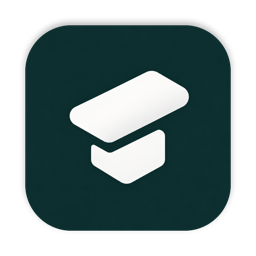
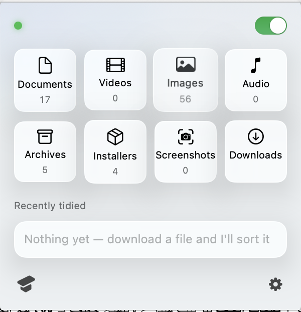

<p align="center">
  
</p>

<h1 align="center">TidyMac</h1>

<p align="center">
  <b>Your Downloads folder, tidy on its own.</b><br>
  A tiny, free menu bar app for macOS that sorts every new download into the right folder,
  and keeps your screenshots in one place.
</p>

<p align="center">
  <a href="https://github.com/4iShmmri/TidyMac/releases/latest"><b>⬇️ Download TidyMac</b></a>
</p>

<p align="center">
  
</p>

---

## What it does

You download a PDF, a video, a photo… and it lands in the right folder by itself, a few seconds
after the download finishes. No clicking, no setup.

```
Downloads/
├── Documents/    PDF, Word, Excel, PowerPoint, Pages, Numbers, Keynote, TXT, CSV, ePub
├── Videos/       MP4, MOV, MKV, AVI, WebM
├── Images/       JPG, PNG, GIF, HEIC, WebP, SVG
├── Audio/        MP3, M4A, WAV, AAC, FLAC
├── Archives/     ZIP, RAR, 7Z, TAR, GZ
└── Installers/   DMG, PKG, ISO
```

- **Automatic.** Every finished download goes to its folder. Folders are created when they're first needed.
- **Screenshots in one place.** New screenshots are saved straight into `Desktop/Screenshots`.
- **Safe.** Files that were already in Downloads are never moved on their own, and downloads still in
  progress are never touched. Only loose files are sorted: folders, and anything inside them, are left alone.
- **Light.** Under 1 MB, lives in the menu bar, follows light and dark mode, starts with your Mac.

## How to use it

1. **Install.** Download the `.dmg` file from [Releases](https://github.com/4iShmmri/TidyMac/releases/latest),
   open it, and drag TidyMac into Applications.
2. **Open it once.** TidyMac appears as a small icon in the menu bar at the top of the screen.
   From now on it starts by itself whenever you turn on your Mac.
3. **That's it.** Download files as usual and they'll be sorted for you.

### The menu

Click the TidyMac icon in the menu bar:

| | |
|---|---|
| **Folders** | Click any folder to open it in Finder. **Press and hold** to see its size, how many files it holds, and where it is. |
| **Switch** (top right) | Turn automatic sorting on or off. The dot is green while it's on, red while it's off. |
| **Recently tidied** | The last files that were moved. **Drag** one out to use it anywhere, or **press and hold** to see its size and location. |
| **TidyMac icon** (bottom left) | **Tidy now**: sorts *everything* loose in Downloads, including older files, plus old screenshots on the Desktop. A ring shows the progress. |
| **⚙︎** (bottom right) | Open at login, screenshots folder, language, quit. |

### Keyboard shortcut

Press **⌃⌥T** (Control + Option + T) from any app to run **Tidy now** without opening the menu.

## First launch

If macOS says TidyMac "can't be opened", open **System Settings → Privacy & Security**,
scroll down and click **Open Anyway**. You only need to do this once.

TidyMac will also ask for access to your Downloads and Desktop folders, which it needs to move files.

## Build from source

Requires macOS 14 or later and Xcode.

```sh
git clone https://github.com/4iShmmri/TidyMac.git
cd TidyMac
./scripts/build.sh --install   # builds TidyMac.app, copies it to /Applications and opens it
./scripts/make-dmg.sh          # builds build/TidyMac-<version>.dmg
```

### Where things are

| File | What's in it |
|---|---|
| [`Rules.swift`](Sources/TidyMac/Rules.swift) | The file types for each folder, the keyboard shortcut, timings. **Start here to add a file type.** |
| [`Organizer.swift`](Sources/TidyMac/Organizer.swift) | Watching Downloads and moving files |
| [`MenuView.swift`](Sources/TidyMac/MenuView.swift), [`Components.swift`](Sources/TidyMac/Components.swift) | The menu bar panel |
| [`Strings.swift`](Sources/TidyMac/Strings.swift) | All text, in English and Arabic |
| [`Settings.swift`](Sources/TidyMac/Settings.swift) | What TidyMac remembers between launches |
| [`System.swift`](Sources/TidyMac/System.swift) | Screenshot location and open at login |
| [`make-icon.swift`](scripts/make-icon.swift) | Builds the app and menu bar icons from `Resources/IconSource.png` |

## License

[MIT](LICENSE) © M.Alshmmari
